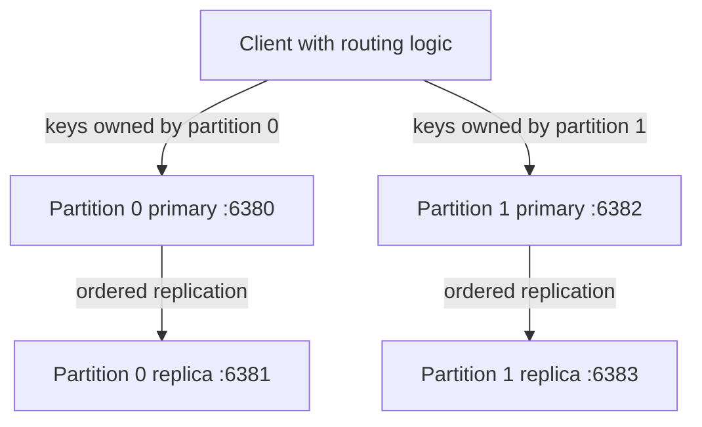

# Part 7: Distribution

## Purpose and scope

Split the keyspace across multiple database groups while preserving the replication
and persistence behavior we already understand. Learn how a client finds the owner
of a key, what happens when that owner is unavailable, and what changing ownership
requires.

This is a sequence of learning milestones, not a requirement to implement every
feature of a production distributed database. Start with **7A: fixed partitions**.
Finish, test, and explain that milestone before choosing the next one. **7B:
consistent hashing and offline rebalancing** is the recommended follow-up.
Automatic failover, consensus, quorums, and online migration are separate advanced
tracks, not hidden prerequisites for routing a request.

Requirements describe observable behavior and correctness boundaries. Example
names and message syntax are illustrative. Prefer small functions and the existing
socket/store patterns; no generic networking framework or configuration service
is needed. Guidance does not mean implementing all checkpoints at once.

## Connect this to what we built

Replication makes another copy of the same ordered history. Partitioning divides
different keys between owners. A partition is also called a shard; this document
uses those words interchangeably. A replication group is one primary and its replica.



Each box is a separate process with its own map and log. The four processes must
not share writable persistence files. Copies inside one group share a history ID;
different groups have different history IDs. Sequence 12 in partition 0 is
unrelated to sequence 12 in partition 1. There is no global sequence or global
order across partitions.

A key exists on its owning primary and that primary's replica, not on every node.
Moving a request to another primary does not make that primary a valid owner.

**Make it click:** replication asks, “who has another copy?” Partitioning asks,
“which group owns this key?” They solve different problems and can be combined.

## Roadmap

| Milestone | Included | Learning objective |
| --- | --- | --- |
| 7A: fixed partitions | Two configured partitions, deterministic routing, replicated writes, restart and failure tests | Ownership, routing, independent failure domains |
| 7B: ownership changes | Stable consistent-hash ring, controlled offline migration | Why changing membership moves data |
| Advanced: online migration | Concurrent access during movement, recovery of migration progress | Coordination between old and new owners |
| Advanced: failover/consensus | Safe authority changes, persistent terms, fencing | Why timeout detection does not grant write authority |
| Advanced: quorums/retries | Explicit quorum/read contracts, request identity and deduplication | What acknowledgments and retries actually guarantee |

These advanced tracks are not all promised implementations. Their concepts should
be discussed, and an implementation should answer a specific new learning question.

## 7A assumptions and contract

- Work on loopback with temporary datasets, fixed endpoints, and separate log paths.
- Start with two partitions whose membership does not change while serving requests.
- Begin routing experiments using two standalone servers. Then run the final
  milestone with two primary/replica groups, reusing Phase 6.
- Put the first routing logic in a client, rather than adding a fifth router process.
  A proxy/router server is a possible later exercise, not required infrastructure.
- Route ordinary reads to the owning primary. Do not add replica read balancing,
  automatic promotion, or successful local-only writes during replica failure.
- Keep the synchronous replicated write contract, full histories, finite socket
  waits, bounded workers/queues, socket ownership, and joined-thread lifetimes.
- New cluster-mode datasets may require fresh files. Do not silently repartition
  existing single-group data or migrate old formats at startup.
- Existing standalone and single-group commands/tests must continue to work.
- Assume trusted local processes. Cluster IDs and ownership checks are not authentication.

Supported routed commands are initially SET, GET, DELETE, and EXISTS. All four
must use the same ownership rule. HELP and EXIT remain client/session operations.
Cluster-wide SIZE and COMPACT must be explicitly unsupported in the first version;
do not silently return one partition's SIZE as the cluster total. Direct node SIZE
remains local, and replication-mode compaction remains disabled.

For a routed write, success keeps its Phase 6 meaning: the owning primary and its
replica persisted/applied the mutation and the primary checked the ACK. It does
not imply that any other partition participated. No cross-partition transaction
or atomic snapshot is promised.

## Step 1: Design ownership without networking

Write down a deterministic function from key bytes to a partition ID. For fixed
membership, a suitable starting rule is:

```text
owner(key) = stable_hash(key) % 2
```

Choose and document a small explicit hash algorithm before implementing it. Define
the byte encoding, integer width, overflow behavior, and partition ordering. Hash
the whole key; do not use a random value or a process-dependent default. Do not
assume `std::hash<std::string>` is a durable cross-build routing specification.
An established non-cryptographic byte hash is sufficient; cryptographic hashing
is not required for this local exercise.

Required checks:

- The same key maps to the same owner in different processes and after restart.
- Client and server ownership checks use the same implementation and specification.
- Known test vectors have fixed expected owners, including quoted/space-containing
  keys, non-ASCII bytes under the chosen encoding, and long valid keys.
- A small fixed dataset reaches both partitions. Equal distribution is not promised
  for every dataset; skew is something to measure, not fix with special cases.

**Predict first:** what changes if `% 2` becomes `% 3`? A new mapping does not move
the bytes already stored under the old mapping.

## Step 2: Route requests to two fixed servers

Use two standalone processes first to isolate routing from replication. Configure
a small ordered mapping from partition IDs to primary endpoints. Fixed startup
configuration is enough; nodes do not discover or elect each other.

The client should:

1. Validate/extract the actual key using the current quoted-field rules.
2. Compute its owner.
3. Send the ordinary command to that owner's endpoint.
4. Return the server's response without changing its meaning.

Do not route based on the raw command line: `GET "full name"` and
`SET "full name" "Durval"` must identify the same key. Reject malformed requests
before routing if the key cannot be determined. Preserve existing message limits,
partial-send handling, framing, and finite waits.

Begin with sequential client requests and an explicit socket owner. A simple
connection strategy is acceptable; persistent per-partition sockets are an
optimization to choose deliberately. If requests later share a connection across
threads, synchronize the complete request/reply exchange as in Phase 6.

Verify SET, overwrite, GET, EXISTS, DELETE, and missing DELETE for keys belonging to
each partition. A key on partition 0 must not appear in partition 1's map/log.
Diagnostic output may show the chosen owner, but keep it separate from protocol
responses. A dashboard is unnecessary.

**Checkpoint:** explain one routed SET and one GET before changing the servers.

### Implemented checkpoint: client routing

Build with `cmake --build build-release`. Start two standalone servers with
separate fresh logs, each in its own terminal:

```sh
# Terminal 1: partition 0
partition_dir=$(mktemp -d)
./build-release/kv_server "$partition_dir/store.log" 6380 --partition 0
```

```sh
# Terminal 2: partition 1
partition_dir=$(mktemp -d)
./build-release/kv_server "$partition_dir/store.log" 6382 --partition 1
```

```sh
# Terminal 3: ports are ordered by partition ID, not discovered automatically.
./build-release/kv_client --cluster 127.0.0.1 6380 6382
```

Try these commands (`color` belongs to partition 0; `full name` to partition 1):

```text
SET "color" "blue"
SET "full name" "Durval"
GET "color"
GET "full name"
EXISTS "color"
DELETE "full name"
EXIT
```

The client validates each command, hashes only its decoded key, opens a connection
to the selected port, sends the original command, reads one response, and closes
the connection. HELP and EXIT run locally. SIZE and COMPACT report unsupported;
they do not accidentally operate on only one partition. Both ports currently use
the same IPv4 address. The original single-server invocation is still available:
`./build-release/kv_client 127.0.0.1 6380`.

One connection per request deliberately avoids idle connections occupying server
workers. It adds connection overhead; this client is for routing correctness, not
the existing benchmark. Connection establishment waits at most five seconds;
sends and receives use five-second socket timeouts. These are per-call I/O waits,
not an absolute deadline against a peer that continually sends tiny fragments.

A failed connection reports PARTITION_UNAVAILABLE. A failed exchange reports
REQUEST_UNCONFIRMED because a write may already have been applied. No automatic
retry occurs. The session continues so another partition can still be used, but
its final process exit status records any connection/exchange failure.

`kv_distribution_tests` launches two servers and checks routing, quoted and UTF-8
keys, overwrites, reads, existence, deletion, invalid/local commands, and a healthy
partition remaining usable after the other stops. Existing single-server and
replication tests remain in place.

Step 2 introduced client routing. Step 3 now also enforces server ownership when
started with `--partition`, as in the commands above. Keep the same endpoint
ordering when reusing logs: swapping ports sends requests to the wrong owner,
which now rejects them rather than silently accepting misplaced data.

## Step 3: Make ownership an enforced server rule

Client routing alone is a convention. A misconfigured client could send a write
directly to the wrong node. Add explicit partition identity to cluster-mode nodes
and reject ordinary keyed requests for another owner before mutation or logging.
Use a clear error such as WRONG_PARTITION; the exact spelling is a protocol choice.

Requirements:

- Direct requests to the wrong partition are rejected, not treated as absent keys
  and not silently stored in a second location.
- Validate commands before extracting/checking their key. Do not introduce a
  second incompatible interpretation of quoted strings.
- Keep the partition ID, routing algorithm/version, partition count, endpoint
  ordering, and group/history association fixed for a populated deployment.
- Bind/validate populated cluster logs against their configured partition/group
  identity on restart. A wrong log/configuration pairing must fail clearly.
  Reuse the expected history ID and fixed routing definition where sufficient;
  do not build a general metadata service. Document any additional persisted metadata.
- Ownership concerns ordinary client requests. Retain the separate peer protocol,
  history verification, and read-only replica rules from Phase 6.

Manually changing configuration is not a supported membership change. Making an
old key unreachable is data loss from the client's perspective even if its bytes
still exist in a file.

### Implemented checkpoint: server ownership

Add `--partition 0` or `--partition 1` after the positional server arguments.
The optional `--history-id` and `--partition` pairs may appear in either order.
Without `--partition`, the server retains its previous unpartitioned behavior.

The command processor validates syntax, checks the decoded key against the
store's fixed partition identity, and only then executes the command. Wrong-owner
SET, GET, DELETE, and EXISTS return:

```text
ERROR WRONG_PARTITION "Key belongs to another partition"
```

The connection stays usable; rejection changes neither map nor log. Commands
without keys keep their existing single-node behavior. Replica client writes are
still read-only, and the numbered peer protocol remains separate. Peer mutations
and replayed records also validate ownership before applying any data.

Fresh partition logs begin with an explicit routing identity:

```text
PARTITION 0 fnv1a64-mod2-v1
```

Numbered logs put their existing `HISTORY <id>` header next, followed by mutations
starting at sequence 1. The partition header is not a numbered record and is not
included in startup replication history. Standalone compaction preserves it.
On restart, the configured partition and routing version must match the header;
omitting the partition flag also fails. Every recovered key must belong here.
The existing expected history-ID check still validates numbered group identity;
use a distinct history ID for each pair and the same ID/partition on both members.
This is configuration, not automatic discovery or authentication.

Nonempty logs created before partition metadata cannot be opened with
`--partition`. Keep those logs for their previous unpartitioned mode and use fresh
files for this milestone. Automatic migration or adding headers to populated
logs is deferred. Restart existing partitioned files with their original
partition flag and, for replicated groups, expected history ID.

To observe enforcement, connect directly to partition 1:

```sh
./build-release/kv_client 127.0.0.1 6382
```

```text
SET "color" "blue"
GET "color"
```

Both return WRONG_PARTITION because `color` belongs to partition 0. The tests
cover wrong-node operations, unchanged logs, same-configuration restart, swapped
or omitted partition identity, malformed routing headers, compaction, numbered
replay/resends, and compatibility with a partitioned primary/replica pair.
The two-group replica-failure/recovery scenario is now automated under Step 5;
other acceptance checks remain listed below.

## Step 4: Combine partitioning with replication

Replace each standalone partition with its own primary/replica pair. Use a small
written topology showing partition ID, primary endpoint, replica endpoint, history
ID, and both log paths. For example, ports 6380/6381 form group 0 and 6382/6383 form
group 1. These are configurable local examples, not magic protocol values.

The write flow is:

```text
Client computes owner
→ owning primary validates ownership and applies mutation
→ that primary sends its numbered record to its own replica
→ replica verifies/applies and ACKs
→ primary responds to client
```

Required behavior:

- Only the owning group receives the mutation; do not broadcast SET to both groups.
- Each group has independent sequence progress, replication connection, and failure
  state. Reuse existing ordering locks within a primary; do not introduce a global
  lock across all partition processes.
- Each primary completes its own startup verification/catch-up before serving new
  commands. An unrelated group's progress must not be mistaken for its own.
- Direct replica writes remain rejected. Server restart preserves ownership and
  data, using the same explicit configuration and log assignments.
- Current limits remain visible: two client workers per server, one peer session
  per replica process, and manual process restart for reconnection.

First prove correctness with one client. Then test two clients accessing different
partitions and the same partition. Partitioning does not remove the need to
synchronize two writers to the same store.

## Step 5: Exercise partial failure and retries

Use controlled local process failures and existing fake-peer techniques. Separate
a known rejection from an uncertain outcome after transmission or local work.

| Scenario | Required behavior |
| --- | --- |
| Partition 0 primary unreachable | Requests for its keys fail visibly; do not redirect writes to partition 1 |
| Partition 0 unavailable, partition 1 healthy | With a client able to reach group 1, its keys remain usable; isolate connection errors instead of requiring every endpoint to be up |
| Replica 0 fails | Group 0 retains Phase 6 uncertainty/write-rejection behavior; group 1 is unaffected |
| Client loses a write response | Do not claim the write was absent or automatically replay it as a new request |
| Both groups restart with their saved logs | Recover each group's data, identity, numbering, and routing independently |
| Wrong partition/configuration or history ID | Reject visibly without silently merging, overwriting, or renumbering data |

A routing layer must preserve an upstream uncertain response. A broken connection
after sending a request can also be uncertain even if no application response
arrives. Do not turn these into NOT_FOUND or a guaranteed rejection.

The baseline does not promise exactly-once client execution or automatic write
retries. Retrying DELETE can legitimately return zero after an earlier attempt
already deleted the key. Request IDs and persisted deduplication are a later track.

**Make it click:** an unhealthy partition does not make another partition the
owner. Failure detection, ownership, and write authority are different decisions.

### Implemented check: replica failure stays within its group

`kv_distribution_tests` now starts two independent primary/replica pairs and
uses the routing client to write to both. It stops replica 0, checks that the next
write reports REPLICATION_UNCERTAIN, and verifies later SET/DELETE requests are
rejected while GET still reads the locally applied value. The same client session
continues to read/write group 1. Log checks confirm that rejected writes append
nothing and that group 1's primary and replica stay synchronized.

The test then restarts only group 0 with the original logs and identities. A direct
read from its replica verifies catch-up of the uncertain write; the next successful
write advances the sequence without gaps or duplicate application. Group 1 is
never restarted. This covers graceful replica-process loss and manual recovery;
it does not add automatic reconnection, failover, or exhaustive network faults.

Run this focused suite with:

```sh
ctest --test-dir build-release -R kv_distribution_tests --output-on-failure
```

## Step 6: Validate and report the fixed-partition milestone

Keep routing tests separate from multi-process integration tests. Use the existing
C++ test style for pure routing/parser logic and the current Python harness for
process/network scenarios. Reuse isolated files, selected ports, finite waits,
and reliable cleanup. Existing Phase 6 suites must continue to pass.

### Implemented check: concurrent clients and full restart

`kv_distribution_tests` runs two routing-client processes, with a test barrier
releasing their launches together. Each sends 100 writes: first to separate
partitions, then to the same key on partition 0. It checks every response, exact
mutation contents/counts, consecutive sequence numbers, each client's write order,
and byte-for-byte matching primary/replica logs. It accepts either client's final
value for the shared key; scheduling does not guarantee which client writes last
or any particular interleaving.

The test reads final values from both primaries and replicas, stops all four
servers, and restarts both groups using their original logs and identities.
Values and logs must survive unchanged. One additional write to each group must
replicate with the next sequence number. This is a correctness test, not a
throughput measurement or proof that every possible thread interleaving is safe.

Acceptance checks for 7A:

- Stable routing test vectors and identical client/server ownership results.
- Full keyed-command lifecycle on both partitions, including quoting and limits.
- Wrong-node requests rejected without modifying maps or logs.
- No duplicate ownership: each key is found only in its owning replication group.
- Two clients preserve per-group ordering, data, and matching replica histories.
- Saved-log restarts retain ownership; misassigned logs/configuration are rejected.
- One failed group does not prevent successful requests to an independent healthy group.
- Replication failure and uncertain client outcomes retain their documented meaning.
- Shutdown closes owned sockets and joins workers; adding connections does not
  silently exhaust all workers required for reads or recovery.
- Unsupported cluster-wide commands are rejected explicitly.

Write a short `docs/distribution-results.md` with topology, routing definition,
success/error guarantees, one normal request trace, one restart trace, and one
single-group failure example. Mark illustrative exchanges separately from captured
outputs, as in the replication report.

Make one measured comparison using equivalent Release builds, values, request
counts, and acknowledgment policy: one replicated group versus two replicated
groups. Use multiple clients and keys that actually reach both groups when asking
whether work spreads. One sequential client cannot establish maximum parallel
capacity. Keep routing, connection setup, and startup timing boundaries explicit.
Record per-group request counts to reveal skew; no speedup is an acceptable result.
Do not blame replication for routing costs or compare unlike success contracts.

The [fixed-partition results](distribution-results.md) record the completed local
comparison and existing correctness evidence. The benchmark now supports
`--cluster <primary-0-port> <primary-1-port> [GET|SET|VERIFY]`, using two persistent
connections with explicit per-group measured request counts.

**7A is complete** when two fixed replicated groups own disjoint keys, routing
survives restart, failure stays visible and isolated, and you can explain which
guarantees apply to one key versus the whole cluster. Stop here for a review before
expanding membership behavior.

## 7B, Step 7: Study consistent hashing without moving data

Fixed modulo routing is enough for 7A. Now compare it with a consistent-hash ring
using the same key dataset and two versus three group IDs. Map ring positions to
replication groups, not separately to a group's primary and replica.

Choose a stable hash/position representation and deterministic collision/tie
rules. Define ownership as the first group position clockwise from the key,
including wrap-around. Stable group IDs must not change because a process restarts.
One position per group is sufficient to learn the mechanism; virtual nodes are a
separate imbalance experiment, not mandatory initial infrastructure.

Measure the fraction of keys whose owner changes, plus distribution/skew. Explain
why reducing reassignment can help membership changes but does not transfer any
stored data. Consistent hashing is not replication, failover, or consensus.

Use fresh datasets when switching from the old routing algorithm unless an
explicit migration is implemented. Do not point the new mapping at populated
7A logs and assume existing data has moved.

### First experiment implemented

`kv_partition_experiment` implements sorted-list lookup and compares modulo
with a one-position-per-group ring over 10,000 fixed keys. The ring now uses
FNV-1a followed by fmix64 for both keys and group IDs. The
[experiment notes](hash-ring-experiment.md) preserve the original clustered FNV
baseline alongside the new mixed result: positions spread, movement decreases for
this dataset, and substantial imbalance remains. Virtual nodes are the next
separate experiment. Live routing and log formats are unchanged.

## 7B, Step 8: Implement a controlled offline rebalance

Begin with a stopped/quiesced deployment and a fixed old mapping and new mapping.
No client traffic is admitted during migration; this deliberately avoids concurrent
writes, delete races, and dual-owner coordination in the first migration exercise.

For this small dataset, the simplest safe strategy may rebuild all groups into
fresh destination logs from the retained logical state. Incremental transfers are
optional. Destination groups are new histories; do not splice independent source
sequence numbers into one destination history or copy history IDs across groups.
Replicate destination writes using the existing success contract.
Recover/synchronize each source group before freezing its dataset, and read one
authoritative primary snapshot per group rather than counting replica copies twice.

Required behavior:

1. Record the old/new routing definitions and identify source/destination groups.
2. Keep original logs intact and unavailable for writes during the migration.
3. Transfer each live key to exactly its new owner, preserving its value. Rebuilding
   from live state must not resurrect keys deleted in the source history.
4. Verify destination contents/counts against the source dataset, not just a sum
   that could conceal missing and duplicated keys.
5. Persist the completed destination topology and activate it as one deployment
   while traffic remains stopped. Do not leave some clients on the old mapping.
6. Resume traffic only against the verified new deployment; retain old logs until
   the migration is accepted.

A partial transfer must not be published as a completed topology. For this first
version, discarding incomplete destinations and retrying from intact sources is
enough; resumable migration is optional. Test interruption before publication,
restart of the new deployment, moved/unmoved keys, overwritten values, and deleted
keys. Adding a group to a configuration list alone is not a rebalance.

## Advanced tracks: choose a concrete question first

### Online membership and migration

Only after offline migration works, consider admitting requests during transfer.
You then need an ownership/configuration version, a rule for old versus new
requests, handling of concurrent writes/deletes, stale-router detection, and a
recoverable handoff. Define these before implementing background copying. Neither
the old nor new owner may independently accept incompatible authoritative writes.

### Failure detection, election, and fencing

A timeout shows lack of communication, not proof that a primary stopped. Simply
promoting a replica can create two writable primaries after a network partition.
Manual experiments must stop/fence the old primary before changing authority.

An automatic election track is a separate substantial milestone. Prefer learning
one established consensus protocol with its actual safety rules over inventing
an election by timeout or highest node ID. Majority-based experiments normally
need at least three voting members to keep making progress after one member fails;
our two-node synchronous groups do not acquire that property by adding a heartbeat.
Persistent terms/votes, log agreement, and enforcement of authority are required
parts of that track, not implementation details to defer until after promotion.

### Quorums and consistency

Define the read/write contract before selecting replica counts or acknowledgment
thresholds. Overlapping read/write quorums alone do not provide linearizability,
resolve conflicting versions, or guarantee fresh reads. Quorum experiments would
change the current all-configured-copies write contract and require new tests.

Discuss network partitions using concrete outcomes: which clients can receive
successful writes, which reads may be stale, and what happens after communication
returns. Do not label the entire project CP/AP without specifying the operations
and failure assumptions. Replica reads during catch-up already show why a global
claim of strong consistency would be too broad.

### Client retries and global operations

Request IDs and deduplication can make uncertain retries safer, but deduplication
state must survive the failures covered by the promise. Replication record numbers
identify history entries; they are not automatically client request IDs.

A cluster-wide SIZE can later query every primary and sum local counts, excluding
replicas. It must fail or explicitly report incompleteness when one group is
unavailable, and concurrent updates mean the sum is not an atomic snapshot.
Cross-partition transactions need their own contract; they are not implied by a
successful single-key SET.

## First session

Before editing networking code:

1. Draw two partitions and place their primary/replica processes and files.
2. Explain where one sample key would live and which nodes must ACK its SET.
3. Choose/document the stable ownership rule for fixed membership.
4. Write the pure routing function and a few fixed test vectors.
5. Stop and inspect those results before connecting it to the client.

The next implementation task is only Step 1. The rest of this document is the
roadmap, not an instruction to build every layer in one change.
